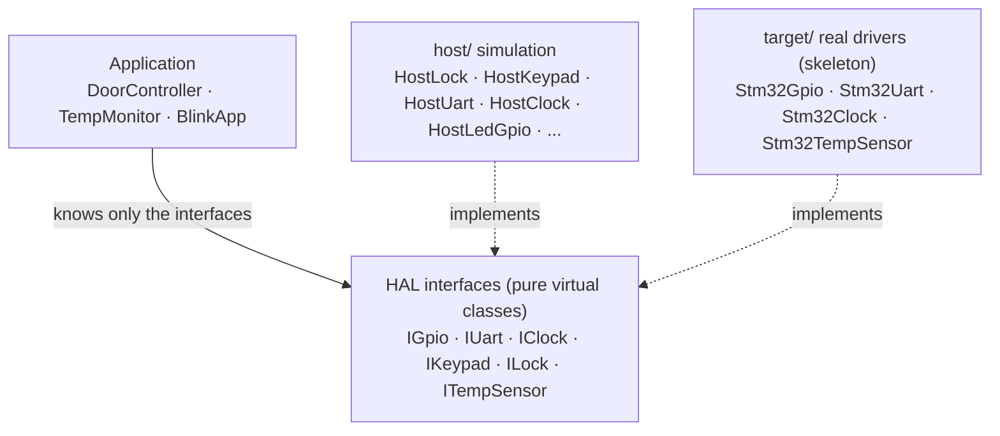
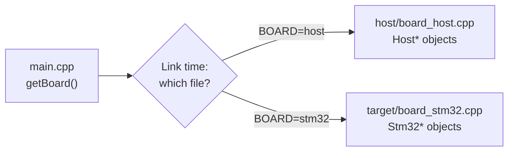
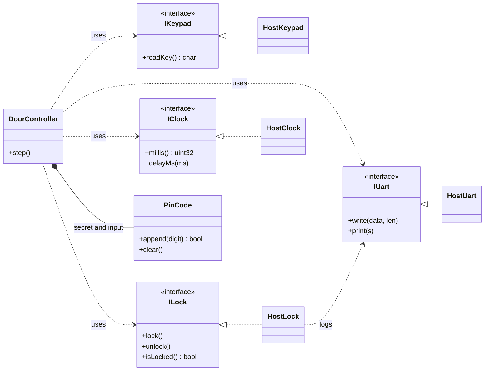
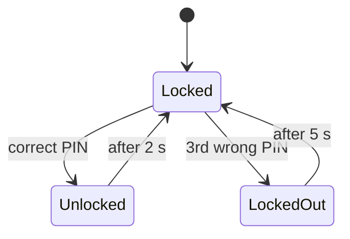

# Embedded C++ Polymorphism Demo

Small, buildable demos that show how C++ inheritance, `virtual` functions and vtables let you **run embedded application code on a PC without hardware**.

## Idea

Application code does not use the hardware directly. It goes through a **hardware abstraction layer** (HAL) made of interfaces. Behind those interfaces you plug in a simulation on the PC and a real driver on the target board. The application code never changes, only the concrete classes behind the interfaces do.

This gives you three things:

- You can test the logic on a PC in seconds, with no hardware.
- Time is abstracted too, so scenarios run on **virtual time**: `delayMs` does not wait, it advances a clock. Demos finish instantly and print the same output every run.
- Moving to the board changes a single source file (the definition of the `getBoard()` family of functions).

## Architecture



Every polymorphic class has a vtable and every object carries a `vptr`. A call through an interface is dispatched at run time to the object's real class.

Which concrete objects are used is decided in one function (`getBoard()`, `getSensorBoard()`, `getDoorBoard()`). Its definition lives in a file under `host/` or `target/`, and the choice is made **at link time**. There is no `#ifdef` in the application code.



## Demos

| Demo | What it shows | Run |
|---|---|---|
| [door_demo](door_demo) | PIN door lock. State machine, `explicit`, a value type (`PinCode`), `.hpp`/`.cpp` split. **Main example.** | `make run-door` |
| [led_demo](led_demo) | LED and button. `virtual`, `override`, a virtual function with a default body, a hand-written vtable (`vtable_demo.cpp`). | `make run-led`, `make run-vtable` |
| [sensor_demo](sensor_demo) | Temperature sensor with a hysteresis alarm. Adding a new HAL interface. | `make run-sensor` |

### door_demo

The user enters a PIN on a keypad. A correct PIN unlocks the door for 2 seconds, then it locks itself again. Three wrong attempts start a 5-second lockout.

`DoorController` only knows the interfaces. On the host, simulation classes sit behind them:



`DoorController` is a state machine:



Example output:

```text
[    0 ms] UART: boot
[ 1300 ms] UART: wrong PIN (1/3)
[ 2800 ms] UART: PIN ok
[ 2800 ms] UART: lock: UNLOCKED
[ 4800 ms] UART: lock: LOCKED
[ 7800 ms] UART: wrong PIN (1/3)
[ 8800 ms] UART: wrong PIN (2/3)
[ 9800 ms] UART: too many attempts, locked out
[16300 ms] UART: PIN ok
[16300 ms] UART: lock: UNLOCKED
[18300 ms] UART: lock: LOCKED
```

## C++ concepts shown

- **Pure virtual interfaces and virtual destructors:** `common/hal.hpp`, `door_demo/door_hal.hpp`
- **Virtual function with a default body:** `IGpio::toggle()` (`common/hal.hpp`)
- **`override` and `final`:** the host classes (`common/host_hal.hpp`, `*/host/`)
- **`explicit`:** the `PinCode`, `HostLock`, `HostKeypad` and `HostUart` constructors
- **`const` member functions:** `ILock::isLocked()`
- **Reference members and dependency injection:** `Board`, `SensorBoard`, `DoorBoard`
- **Static objects, no heap:** `*/host/board_host.cpp`
- **Platform selection at link time:** the `getBoard()` family and the CMake `BOARD` option
- **Hand-written vtable:** `led_demo/vtable_demo.cpp`
- **Virtual time:** `HostClock` (`common/host_hal.hpp`)

## Repository layout

```text
.
├── common/              shared HAL interfaces, host and STM32 classes
├── door_demo/           door lock demo
├── led_demo/            LED and button demo (+ vtable_demo.cpp)
├── sensor_demo/         temperature sensor demo
├── .github/workflows/   CI (build.yml)
├── .vscode/             build task and debug configurations
├── CMakeLists.txt       top-level project
└── Makefile             alternative build
```

Every demo follows the same layout:

```text
door_demo/
├── door_hal.hpp         interfaces (IKeypad, ILock) and DoorBoard
├── app/                 application logic (PinCode, DoorController)
├── host/                PC simulation (HostKeypad, HostLock, getDoorBoard)
├── main.cpp
└── CMakeLists.txt
```

`led_demo` and `sensor_demo` also have a `target/` folder (STM32 skeleton).

## Build and run

Requirements:

- A C++17 compiler (tested with g++ 11)
- CMake 3.16 or newer (3.20 or newer for `ctest --test-dir`)
- GNU Make (`mingw32-make` on Windows MinGW). The Makefile uses `cmake -E` to create and remove directories, so CMake must be installed when building with Make as well.

### CMake

```bash
cmake -S . -B build
cmake --build build
ctest --test-dir build --output-on-failure
./build/door_demo/door_demo
```

On Windows with MinGW, add `-G "MinGW Makefiles"` to the first command. Executables go to `build/<demo>/` (with a `.exe` suffix on Windows).

With CMake older than 3.20, use `cd build && ctest` instead of `ctest --test-dir build`.

### Makefile

```bash
make               # build all demos (on Windows MinGW: mingw32-make)
make run-door      # door lock demo
make run-led       # LED and button demo
make run-sensor    # temperature demo
make run-vtable    # hand-written vtable demo
make run           # run all of them in sequence
make clean
```

Outputs go to the `out/` folder.

## Tests

Each demo also runs as a `ctest` test. The test searches the program output for an expected string:

- `door_demo`: `too many attempts, locked out` (the lockout must trigger)
- `led_demo`: `button pressed`
- `sensor_demo`: `ALARM`
- `vtable_demo`: it only has to exit successfully

## Continuous integration

[GitHub Actions](.github/workflows/build.yml) runs on every `push` and `pull_request` on Ubuntu and:

1. Configures with CMake with `-Wall -Wextra` enabled, and builds.
2. Runs the demos through `ctest`.
3. Rebuilds with the Makefile and runs `make run`.

## Status and limitations

- **The host side** (the `host/` folders) was built and run on Windows with MinGW g++. The Linux build is checked by GitHub Actions on every push.
- **The STM32 files** (the `target/` folders and `common/stm32_hal.hpp`) are a **skeleton**. They need the ST HAL headers and an `arm-none-eabi` toolchain, and in this repository they are **not built and have not been tested on real hardware**. Their purpose is to show which file changes when you move to a board. The `-DBOARD=stm32` configuration is therefore only a starting point.
- `door_demo` has no target file yet. Configuring with `BOARD=stm32` makes CMake fail.
- The PIN comparison (`PinCode::operator==`) is not constant-time and is not good enough for a real product.
- Virtual time does not model real-time behavior such as interrupts, latency or race conditions.
